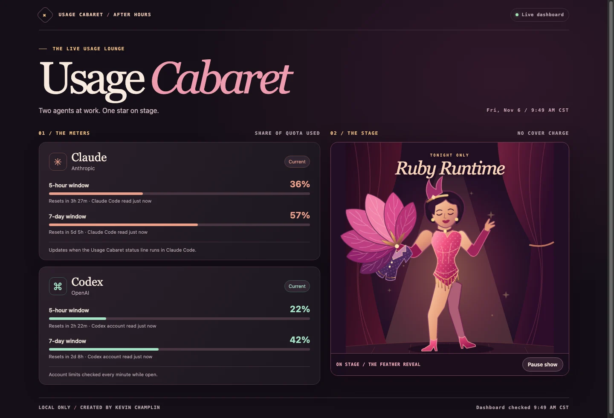

# Usage Cabaret

**An open-source usage dashboard for Claude Code and Codex.** See five-hour and weekly quotas, rate limits, and reset countdowns side by side as each provider reports them. Ruby Runtime performs a looping feather-fan quick change while you work. The show has a pause button and respects reduced motion.

**Created by [Kevin Champlin](https://github.com/Kevinchamplin).**



*Screenshot with sample quota readings.*

## Start the dashboard

Install Node.js 22 or newer. For Codex readings, install the Codex CLI and sign in to a ChatGPT account. For Claude readings, use a Claude Code version and plan that report quota in the status line.

```sh
git clone https://github.com/Kevinchamplin/usage-cabaret.git
cd usage-cabaret
node server.mjs
```

Open [localhost:4876](http://127.0.0.1:4876/) on the same computer. On macOS, add `--open` to open the browser automatically. The server listens only on `127.0.0.1`. Stop it with Ctrl+C.

Codex reads account quota through its [app server](https://learn.chatgpt.com/docs/app-server#rate-limits-chatgpt) while the dashboard is open.

## Connect Claude Code

Add a `statusLine` entry to your Claude Code user settings at `~/.claude/settings.json`. Replace both example paths with absolute paths. Find Node's path with `command -v node` in your terminal.

```json
{
  "statusLine": {
    "type": "command",
    "command": "\"/absolute/path/to/node\" \"/absolute/path/to/usage-cabaret/claude-statusline.mjs\""
  }
}
```

Keep your other settings. If you already use a custom status line, back up its configuration before replacing the entry. The helper displays a compact quota readout in Claude Code and saves just the quota percentages and timestamps under `~/.usage-cabaret/`. Open Claude Code and use it normally. The dashboard updates as Claude Code supplies readings through its [status line](https://code.claude.com/docs/en/statusline#rate-limit-usage). A provider can omit a window, and older readings are marked in the dashboard.

The collectors make no model requests of their own. The dashboard receives quota fields and timestamps.

## Contribute

Bug reports, ideas, and pull requests are welcome. The stage is an SVG with CSS animation, so you can change the act without adding a build step. See [CONTRIBUTING.md](CONTRIBUTING.md) for setup and checks.

Usage Cabaret is released under the [MIT License](LICENSE).
